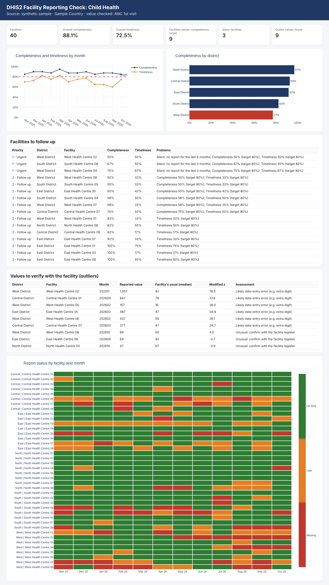

# DHIS2 Facility Reporting Check

A monthly data-quality review for DHIS2, the health information system behind Uganda's national HMIS. It connects to the **DHIS2 Web API** and scores every health facility on **completeness, timeliness and silence**. It also finds **outliers** in a key indicator with a robust modified z-score, then produces a prioritised follow-up list, an Excel report and a dashboard.

**Live dashboard:** `https://matthieumuchu.github.io/dhis2-reporting-check/outputs/dhis2_reporting_dashboard.html` (after enabling GitHub Pages)
**Full guide:** [docs/GUIDE.md](docs/GUIDE.md)



## Key results (offline sample: 40 facilities, 5 districts, 12 months, Child Health data set)

| | |
| --- | --- |
| Overall completeness | **88.1%** (target 80%) |
| Overall timeliness | **72.5%** (below target; dropped to 60% in September 2026) |
| Silent facilities, no report for 3 or more months | **3** (priority 1, urgent) |
| Facilities to follow up | 13 more (below 80% completeness or timeliness) |
| Lowest district | West: 77.1% completeness, 58.3% timeliness |
| Outliers in *ANC 1st visit* | 9, of which **6 are likely data-entry errors** (for example 1,057 reported against a usual 92) |

## How it works

1. **API calls:**
   - `/api/me` gives the user's root org unit;
   - `/api/dataSets` and `/api/dataElements` look up IDs by name;
   - `/api/analytics` pulls `REPORTING_RATE`, `REPORTING_RATE_ON_TIME`, `ACTUAL_REPORTS`, `ACTUAL_REPORTS_ON_TIME` and `EXPECTED_REPORTS` for every facility (`ou:<root>;LEVEL-4`) over `LAST_12_MONTHS`, plus the monthly values of one data element.
2. **Tidy:** the analytics JSON (headers, rows, metaData items and ouHierarchy) becomes facility × month tables with district names.
3. **Score:**
   - completeness = received ÷ expected;
   - timeliness = on time ÷ expected;
   - silent = the last 3 or more expected reports missing;
   - priority 1 = silent, 2 = below target, 3 = OK.
4. **Outliers:** per facility, modified z = 0.6745 × (value − median) ÷ MAD. Above 3.5 is an outlier, and above 10 is labelled "likely data-entry error".
5. **Report:**
   - an Excel workbook (Summary, Facilities, Districts, Monthly, Outliers);
   - CSVs;
   - an HTML dashboard with the monthly trend, district bars, follow-up and outlier tables, and a facility × month status heatmap.

This follows the WHO Data Quality Review dimensions of completeness, timeliness and internal consistency (outliers).

## Quick start

```bash
python -m venv .venv
.venv\Scripts\activate          # Mac/Linux: source .venv/bin/activate
pip install -r requirements.txt
python run_all.py               # offline sample, about 5 seconds
python -m pytest -q             # 7 passed
```

**Run live against the public DHIS2 demo** (Sierra Leone database, login admin / district):

1. Open https://play.dhis2.org, choose an instance and copy its address (`https://play.im.dhis2.org/<instance>`).
2. Copy `.env.example` to `.env` and set `DHIS2_URL` to that address.
3. Run `python run_all.py --live`.

The same settings work for any DHIS2 you have an account on: data set, data element, facility level, period and thresholds are all set in `.env`.

## Project structure

```text
src/config.py           server, login, data set, data element, level, period, thresholds
src/dhis2_client.py     small DHIS2 Web API client + analytics JSON -> table
src/generate_sample.py  offline sample in the exact analytics response format
src/fetch.py            step 1: live API pull or offline sample -> data/*.csv
src/analyse.py          step 2: scores, outliers, Excel, dashboard, heatmap
docs/GUIDE.md           full explanation, live setup, interview notes
```

## Tech stack

DHIS2 Web API (analytics), Python, requests, pandas, NumPy, Plotly, Matplotlib, openpyxl, pytest.

## Data and testing notes

The offline sample is **synthetic**, with silent facilities and outliers planted (answer keys in `data/sample/`), and the tests confirm all of them are found. The live API path is tested with a simulated server. Run it once against the demo to confirm it on your machine. Credentials (`.env`) and raw live downloads (`data/raw/`) are excluded from Git.

## Author

**Matthew Mucunguzi** · [github.com/matthieumuchu](https://github.com/matthieumuchu) · MIT licence
