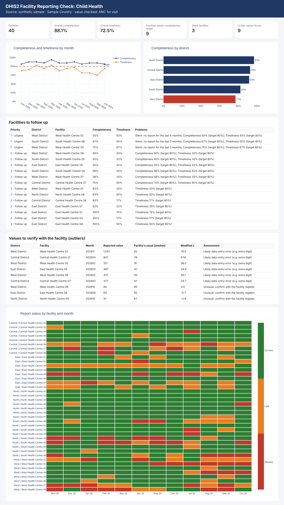

# DHIS2 Facility Reporting Check: Project Guide

*Complete project guide: what it does, how it works, how to run it and how to talk about it.* By Matthew Mucunguzi.

**Contents**

- [1. The project in one paragraph](#1-the-project-in-one-paragraph)
- [2. The problem it solves](#2-the-problem-it-solves)
- [3. Key terms you must be able to explain](#3-key-terms-you-must-be-able-to-explain)
- [4. What is in the folder](#4-what-is-in-the-folder)
- [5. Set it up on your laptop (one time, about 15 minutes)](#5-set-it-up-on-your-laptop-one-time-about-15-minutes)
- [6. Run it offline (sample data)](#6-run-it-offline-sample-data)
- [7. How to read the results](#7-how-to-read-the-results)
- [8. How the code works](#8-how-the-code-works)
- [9. Run it live on the DHIS2 demo server](#9-run-it-live-on-the-dhis2-demo-server)
- [10. Change the settings](#10-change-the-settings)
- [11. Tests](#11-tests)
- [12. Troubleshooting](#12-troubleshooting)
- [13. Put it on GitHub](#13-put-it-on-github)
- [14. How to talk about it](#14-how-to-talk-about-it)
- [15. Honest limits](#15-honest-limits)

## 1. The project in one paragraph

DHIS2 is the health information system used by Uganda's Ministry of Health and in more than 80 countries. This project connects to a DHIS2 server through its Web API and checks the quality of facility reporting, the way a district biostatistician or M&E officer does every month. For every health facility it calculates:

- **completeness** (did it send its monthly report?);
- **timeliness** (did it send it on time?);
- whether the facility has **gone silent** (no report for the last 3 months or more).

It also scans a key data element, *ANC 1st visit*, for **outliers** such as an extra digit typed by mistake. The results are an Excel report, a priority list of facilities to follow up and an interactive dashboard. It works offline on a synthetic sample (40 facilities in 5 districts) and live against the public DHIS2 demo server or any DHIS2 you have a login for.

**What you can say you did:** "I built a Python tool that pulls reporting rates and values from the DHIS2 analytics API and scores every facility on completeness, timeliness and silence. It also detects outliers with a robust modified z-score. On the sample, overall completeness was 88.1% and timeliness 72.5%. It flagged 3 silent facilities as urgent, 13 more for follow-up and 9 suspicious values, 6 of them likely data-entry errors."

## 2. The problem it solves

Health managers use DHIS2 data to order medicines, plan outreach, spot outbreaks and report to the Ministry and donors (PEPFAR, Global Fund, Gavi). That only works if facilities report and the numbers are right. The WHO *Data Quality Review* framework checks four things: **completeness, timeliness, internal consistency (including outliers) and external consistency**. This project automates the first three for one data set.

Typical problems it catches:

- **A facility stops reporting.** The in-charge was transferred, the internet bundle ran out, or the facility closed. Its patients disappear from district totals, so coverage looks like it is falling when it isn't.
- **Late reports.** A report sent after the deadline misses the district's monthly review, and that leads to decisions made on incomplete data.
- **Typing errors.** 1,057 ANC visits entered instead of 105. One wrong number can double a district's total for the month.

In Uganda this is the monthly work of district biostatisticians and HMIS focal persons, and of M&E officers at implementing partners such as IDI, Baylor Uganda, TASO and MildMay. They review the HMIS 105 (monthly outpatient report), the HMIS 033b (weekly surveillance report) and others.

## 3. Key terms you must be able to explain

| Term | Plain meaning |
| --- | --- |
| DHIS2 | District Health Information Software 2. Free, open-source, web-based health information system. Uganda's national HMIS runs on it. |
| Organisation unit (org unit) | A place in the health system hierarchy: country, district, sub-county or health facility. |
| Level | Position in the hierarchy. In the DHIS2 demo (Sierra Leone): 1 = country, 2 = district, 3 = chiefdom, 4 = facility. Uganda's levels differ, so check the server's own hierarchy. |
| Data element | One number collected, for example "ANC 1st visit". |
| Data set | A reporting form: a group of data elements reported together on a schedule, for example the monthly "Child Health" form. |
| Period | The time a value covers, written `202603` for March 2026. `LAST_12_MONTHS` is a relative period. |
| Expected reports | How many reports a facility should have sent (1 per month per assigned data set). |
| Actual reports | How many it did send. |
| Completeness (reporting rate) | Actual ÷ expected. Target here: 80%. |
| Timeliness (on-time reporting rate) | Reports received by the deadline ÷ expected. Target here: 80%. |
| Silent facility | A facility whose last 3 (or more) expected reports are all missing. |
| Analytics API | DHIS2's endpoint (`/api/analytics`) for aggregated data by data item (`dx`), org unit (`ou`) and period (`pe`). The same engine powers DHIS2's pivot tables and dashboards. |
| Analytics tables | DHIS2 pre-computes analytics, usually overnight. Data entered today shows in analytics after the next run. |
| Median | The middle value. Unlike the average, it isn't pulled up by one huge error. |
| MAD (median absolute deviation) | The median of how far each value is from the median. A robust measure of spread. |
| Modified z-score | `0.6745 × (value − median) ÷ MAD`. Above 3.5 (or below −3.5) is an outlier, the standard rule from Iglewicz and Hoaglin. DHIS2's own Data Quality app offers the same method. |

**Why the modified z-score instead of the usual z-score (mean and standard deviation)?** An extreme error inflates the mean and the standard deviation so much that it can hide itself. The median and MAD barely move. With 12 monthly values around 90 and one of 1,057, the median stays about 92 and the 1,057 scores 76.5, impossible to miss.

## 4. What is in the folder

| Path | What it is |
| --- | --- |
| `run_all.py` | Runs everything. `python run_all.py` uses the offline sample; `python run_all.py --live` uses a real DHIS2 server. |
| `src/config.py` | Settings: server, login, data set, data element, facility level, period and thresholds. Each can be overridden in `.env`. |
| `src/dhis2_client.py` | A small, readable DHIS2 API client: `me`, `dataSets`, `dataElements` and `analytics`, plus the converter from the API's JSON to a table. |
| `src/generate_sample.py` | Builds the offline sample in `data/sample/`. The files have exactly the shape of real DHIS2 analytics responses, with silent facilities and outliers planted (answer keys included). |
| `src/fetch.py` | Step 1. Pulls from the live server (`fetch_live`) or loads the sample (`--offline`), and writes tidy tables: `data/reporting.csv` and `data/values.csv`. |
| `src/analyse.py` | Step 2. Scores facilities, districts and months, finds outliers, and builds the Excel report, CSVs, dashboard and heatmap. |
| `.env.example` | Template for your server address and login. Copy it to `.env`. |
| `outputs/dhis2_reporting_report.xlsx` | Sheets: Summary, Facilities, Districts, Monthly and Outliers. |
| `outputs/facility_scores.csv`, `outputs/outliers.csv` | The same as CSV. |
| `outputs/dhis2_reporting_dashboard.html` | The interactive dashboard. |
| `docs/images/` | Dashboard screenshot and status heatmap for the README. |
| `tests/test_dhis2.py` | 7 tests, no internet needed. |

## 5. Set it up on your laptop (one time, about 15 minutes)

These steps are for Windows. Mac and Linux differences are noted in brackets.

**1. Install Python.** Download Python 3.11 or newer from python.org. During installation, tick **"Add python.exe to PATH"**. Check it worked by opening PowerShell (Start menu > type "PowerShell") and running:

```powershell
python --version
```

You should see something like `Python 3.12.4`. [Mac/Linux: use `python3` instead of `python` everywhere below.]

**2. Install VS Code** (code.visualstudio.com) and its Python extension. You will use it to read and edit the code.

**3. Get the project folder.** Unzip `dhis2-reporting-check.zip` into a working folder, for example `C:\Users\<you>\projects\dhis2-reporting-check`. Once it is on GitHub, you can instead run `git clone https://github.com/matthieumuchu/dhis2-reporting-check.git`.

**4. Open a terminal inside the folder.** In VS Code: File > Open Folder > choose the folder, then Terminal > New Terminal.

**5. Create a virtual environment** (a private box of libraries for this project, so it never conflicts with other projects):

```powershell
python -m venv .venv
.venv\Scripts\Activate.ps1
```

[Mac/Linux: `source .venv/bin/activate`.] Your prompt now starts with `(.venv)`. If PowerShell refuses with an "execution policy" error, run `Set-ExecutionPolicy -Scope CurrentUser RemoteSigned`, answer `Y`, and try again.

**6. Install the libraries the project needs:**

```powershell
pip install -r requirements.txt
```

Every time you come back to the project, repeat step 4 and the `Activate` line in step 5. You do not need to reinstall.


## 6. Run it offline (sample data)

```powershell
python run_all.py
```

It takes about 5 seconds. Expected output:

```text
=== src/generate_sample.py ===
Sample: 40 facilities x 12 months; 2022 reporting rows, 423 value rows, 6 planted outliers

=== src/fetch.py --offline ===
Saved 480 facility-months of reporting and 423 values for 40 facilities (synthetic sample).

=== src/analyse.py ===
Overall completeness 88.1%, timeliness 72.5%
priority
1 - Urgent        3
2 - Follow up    13
3 - OK           24
Outliers: 9
                 ou_name     pe  value  facility_median  modified_z
   West Health Centre 02 202511 1057.0             92.5        76.5
Central Health Centre 01 202604  847.0             79.0        57.6
   ...
```

Then open `outputs\dhis2_reporting_dashboard.html` and `outputs\dhis2_reporting_report.xlsx`.

## 7. How to read the results



**Cards:**

| Card | Value |
| --- | --- |
| Facilities | 40 |
| Overall completeness | **88.1%** (above the 80% target) |
| Overall timeliness | **72.5%** (below target, the main weakness) |
| Facilities below the completeness target | 9 |
| Silent facilities | 3 |
| Outlier values found | 9 |

The story in one line: *"Most reports arrive, but more than a quarter arrive late; three facilities have stopped reporting, and six values look like typing errors."*

**Completeness and timeliness by month.** Completeness stays between 85% and 95% all year. Timeliness sits between 70% and 82.5% until June 2026. It then falls to 65% in July and August and to **60% in September 2026**, recovering to 75% in October. Ask what happened in July–September: staff changes, a holiday, network problems, or a new reporting deadline?

**Completeness by district:**

| District | Completeness | Timeliness |
| --- | --- | --- |
| North | 96.9% | 89.6% |
| Central | 92.7% | 78.1% |
| East | 91.7% | 62.5% |
| South | 82.3% | 74.0% |
| **West** | **77.1%** (red, below target) | **58.3%** |

The West district team should be the first support visit. East reports nearly everything but late, which is a training or process issue, not an absence issue.

**Facilities to follow up.** The ranked list:

- **1 – Urgent (silent):**
  - West Health Centre 02: no report for the last **6** months;
  - South Health Centre 08 and West Health Centre 04: no report for the last 3 months.

  Phone the in-charge this week.
- **2 – Follow up (13 facilities):** below 80% completeness or timeliness. Examples:
  - Central Health Centre 06 reports 83% of the time but only **17% on time**;
  - East Health Centre 03 sends every report, but only 17% on time.

  These need a reminder about deadlines, or help with data entry.

**Values to verify (outliers):**

- **Six "likely data-entry errors"** (modified z above 10). For example, West Health Centre 02 reported **1,057** ANC first visits in November 2025 against its usual 92, almost certainly an extra digit (105 or 107). Central Health Centre 01 reported 847 against a usual 79.
- **Three "unusual"** values (z between 3.5 and 10, or below −3.5). These may be real, for example a low month during a stock-out or a staff strike. Check them against the facility's ANC register.

**Report status heatmap** (bottom of the dashboard). Each row is a facility and each column a month: green = on time, amber = late, red = missing. You can see silent facilities as a solid red run at the right edge (West Health Centre 02 from May 2026). Facilities that are always amber have a timeliness problem.

### What you would recommend to the district health team

1. **Call the three silent facilities this week** and find out why: staff, tools, connectivity or closure. Enter the missing reports from the facility's paper registers where possible.
2. **Fix the six likely typing errors in DHIS2** after confirming with the facility registers, then re-run analytics. Otherwise district ANC totals are overstated.
3. **Support visit to West District,** the lowest completeness and timeliness.
4. **Remind all facilities of the reporting deadline** and investigate the July–September timeliness drop.
5. **Run this check every month** after the reporting deadline and share the facility list at the district performance review meeting.

## 8. How the code works

### The API calls (`dhis2_client.py`)

DHIS2 has a REST API: every screen in DHIS2 reads data from it, and so can a script. This project uses four calls, all with your username and password (HTTP Basic authentication):

1. `GET /api/me?fields=organisationUnits[id,name]` returns the org unit your user is assigned to. That becomes the root of the analysis (Sierra Leone on the demo, or your district on a district login).
2. `GET /api/dataSets?filter=name:eq:Child Health&fields=id,name` returns the data set's ID.
3. `GET /api/dataElements?filter=name:eq:ANC 1st visit&fields=id,name` returns the data element's ID.
4. `GET /api/analytics` with three dimensions:

   ```text
   dimension=dx:<dataSetId>.REPORTING_RATE;<dataSetId>.REPORTING_RATE_ON_TIME;
               <dataSetId>.ACTUAL_REPORTS;<dataSetId>.ACTUAL_REPORTS_ON_TIME;
               <dataSetId>.EXPECTED_REPORTS
   dimension=ou:<rootId>;LEVEL-4        (every facility under the root)
   dimension=pe:LAST_12_MONTHS
   showHierarchy=true                    (so each facility's district is known)
   ```

   It is then called a second time, with `dx:<dataElementId>`, for the monthly values.

The analytics response has three parts:

- `headers`: column names (`dx`, `ou`, `pe`, `value`);
- `rows`: the data, using IDs;
- `metaData`: `items` turns IDs into names, and `ouHierarchy` gives each facility's path (`country/district/chiefdom`).

`analytics_to_frame()` turns all of this into a readable table with facility and district names.

You can see the same thing in a browser. Log in to the demo, then open:
`<server>/api/analytics?dimension=dx:BfMAe6Itzgt.REPORTING_RATE&dimension=ou:ImspTQPwCqd;LEVEL-2&dimension=pe:LAST_12_MONTHS`
That is the Child Health reporting rate by district in the Sierra Leone demo, as JSON.

### Step 1: `fetch.py`

It pivots the reporting metrics into one row per facility and month, with `EXPECTED_REPORTS`, `ACTUAL_REPORTS` and `ACTUAL_REPORTS_ON_TIME` as columns. A missing actual report means 0 (DHIS2 leaves out zeros), and months where no report was expected are dropped. It saves `data/reporting.csv`, `data/values.csv` and `data/context.json`, which records the server, data set and element used. In live mode the raw JSON is also saved to `data/raw/`, which `.gitignore` keeps off GitHub.

### Step 2: `analyse.py`

- `facility_scores()`:
  - totals expected, received and on-time reports per facility;
  - completeness = received ÷ expected and timeliness = on time ÷ expected;
  - `trailing_missing()` counts consecutive missing months from the most recent backwards;
  - priority: **1 – Urgent** if silent for 3 or more months, **2 – Follow up** if below either target, **3 – OK** otherwise. A plain-English "problems" text explains why.
- `district_scores()` and `monthly_scores()`: the same sums, grouped by district or by month.
- `find_outliers()`:
  - works per facility, so a big hospital and a small health centre are each judged against their own normal;
  - needs at least 6 months of data;
  - flags values whose modified z-score is above 3.5 or below −3.5, labelling them "Likely data-entry error" when the z-score is above 10.
- `status_matrix()`: 2 = on time, 1 = late, 0 = missing, for the heatmap.
- `build_outputs()`:
  - writes the Excel report, CSVs, HTML dashboard and PNG heatmap;
  - on a large live server, the heatmap shows only the 60 facilities most needing follow-up, and the HTML tables show the first 200 rows;
  - the Excel file always has everything.

## 9. Run it live on the DHIS2 demo server

The DHIS2 team runs public demo servers with a full Sierra Leone database. Anyone can log in with **admin / district**; they reset every night.

**1. Find the current demo address.** Open **https://play.dhis2.org** in your browser. You'll see a list of demo instances for recent DHIS2 versions. Click the latest stable one and log in with `admin` / `district`. Look at the address bar. It will be something like `https://play.im.dhis2.org/stable-2-42-1/dhis-web-dashboard/`. The part you need is everything **before** `/dhis-web-...`, for example `https://play.im.dhis2.org/stable-2-42-1`. The exact name changes with each release, which is why you copy it rather than typing an old one.

> The old address `https://play.dhis2.org/demo` now redirects to the new servers. Redirects drop the login, so scripts must use the final `play.im.dhis2.org` address. If you use the old one, the script stops with a message explaining this.

**2. Check the API works.** In the same browser tab, add `/api/me` to the address (for example `https://play.im.dhis2.org/stable-2-42-1/api/me`). You should see JSON text with `"username":"admin"`.

**3. Put the address in `.env`.** In the project folder, run `copy .env.example .env`, open `.env` in VS Code and set:

```text
DHIS2_URL=https://play.im.dhis2.org/stable-2-42-1
DHIS2_USER=admin
DHIS2_PASS=district
```

**4. Run it live:**

```powershell
python run_all.py --live
```

You'll see `Connecting to ... Root: Sierra Leone | data set: Child Health | data element: ANC 1st visit`. The national demo has over a thousand facilities, so the analytics call can take a minute. The outputs are rebuilt from the live data, and the dashboard header shows the server address as its source.

**If it stops with "No dataSets called 'Child Health'"**, the message lists the data sets that do exist. Set `DHIS2_DATASET=` in `.env` to one of them. The same applies to `DHIS2_DATA_ELEMENT`.

> I could not run the live connection from my build environment, because DHIS2's servers were not reachable from it. The code follows the documented DHIS2 Web API and is tested against responses in the exact API format. Run step 4 once on your laptop to confirm it, then update the README with your live results and a screenshot.

### Using it on a real DHIS2 (Uganda HMIS, a partner's instance)

Only do this with permission and your own account, and follow your organisation's data policy.

- `DHIS2_URL` is the address you log in at (without `/dhis-web-...`).
- `DHIS2_USER` and `DHIS2_PASS` are your own login. Analysis starts at **your** assigned org unit, so a district user gets their district.
- `DHIS2_DATASET` is the exact name of the monthly form you want to check. Find names in DHIS2 via Data Entry, or open `<server>/api/dataSets?fields=name&paging=false`.
- `DHIS2_FACILITY_LEVEL` is the level number of facilities on that server. Find it at `<server>/api/organisationUnitLevels?fields=name,level`.
- `DHIS2_DATA_ELEMENT` is the value to scan for outliers.

> **Never commit `.env` or `data/raw/` to GitHub.** Both are listed in `.gitignore`. Real health data, even aggregated by facility, must stay inside the organisation. Keep the public repository on the synthetic sample.

## 10. Change the settings

All of these can go in `.env` (or be edited in `config.py`):

| Setting | Default | What it changes |
| --- | --- | --- |
| `DHIS2_PERIOD` | `LAST_12_MONTHS` | Also `THIS_YEAR`, `LAST_6_MONTHS` or fixed months such as `202601;202602;202603`. |
| `COMPLETENESS_TARGET`, `TIMELINESS_TARGET` | 0.80 | Set them to your programme's targets. |
| `SILENT_MONTHS` | 3 | Missing months in a row before a facility is "silent". |
| `OUTLIER_Z` | 3.5 | Lower it to flag more values, raise it to flag fewer. |

To check a different value for outliers (for example "Measles doses given"), change `DHIS2_DATA_ELEMENT`.

## 11. Tests

```powershell
python -m pytest -q
```

Expected: `7 passed`. They check that:

1. analytics JSON becomes a named table with districts;
2. missing reports count as 0;
3. consecutive missing months are counted correctly;
4. every planted silent facility is marked Urgent;
5. every planted outlier is found;
6. the client builds exactly the right analytics request (dimensions and login), using a fake server;
7. a web page returned instead of data gives a clear error explaining the demo address.

## 12. Troubleshooting

| Problem | Fix |
| --- | --- |
| "returned a web page instead of API data" | Use the `play.im.dhis2.org/...` address from step 1, without `/dhis-web-...` at the end. |
| `401 Unauthorized` | Wrong username or password, or the address redirected. The demo resets nightly, but admin/district always works. |
| "No dataSets called ..." | Copy one of the names listed in the message into `DHIS2_DATASET`. |
| Live run gives 0 facilities | Wrong `DHIS2_FACILITY_LEVEL`, or analytics tables haven't been generated on that server yet. |
| `ReadTimeout` | The server is busy. Try again, use `LAST_6_MONTHS`, or start from a district-level user. |
| Numbers differ from DHIS2's own Reporting Rate Summary | Check the same data set, period and org unit, and note that DHIS2 analytics are only as fresh as the last analytics run. |

## 13. Put it on GitHub

**Option A: upload in the browser (no Git needed).**

1. Go to github.com > **New repository**. Name it exactly `dhis2-reporting-check`, add a one-line description, choose **Public**, and do **not** tick "Add a README" (you already have one). Click **Create repository**.
2. On the next page, click **uploading an existing file**.
3. Open the unzipped project folder on your computer and drag **everything inside it** (not the folder itself) into the browser. Do not upload `.venv`, `__pycache__`, `.pytest_cache` or any `.env` file.
4. Write a commit message such as `Initial version of dhis2-reporting-check` and click **Commit changes**.

GitHub hides files starting with a dot when you drag from Windows Explorer. If `.gitignore` did not upload, click **Add file > Create new file**, name it `.gitignore`, and paste in the contents of the file from the folder.

**Option B: Git on the command line** (install Git from git-scm.com first):

```powershell
git init
git add .
git commit -m "Initial version of dhis2-reporting-check"
git branch -M main
git remote add origin https://github.com/matthieumuchu/dhis2-reporting-check.git
git push -u origin main
```

The `.gitignore` file already keeps `.venv`, caches and secrets out of the upload.

**Make it look finished:**

- On the repository page, click the gear next to **About**. Add the description, plus topics such as `dhis2`, `health-information-systems`, `data-quality`, `public-health`, `python`, `api`.
- Pin the repository on your profile: go to your profile > **Customize your pins** > tick `dhis2-reporting-check`.
- **Publish the dashboard as a live web page (free).** Go to the repository's **Settings > Pages**. Under "Build and deployment", choose **Deploy from a branch**, branch `main`, folder `/ (root)`, then **Save**. After a minute or two the dashboard is live at
  `https://matthieumuchu.github.io/dhis2-reporting-check/outputs/dhis2_reporting_dashboard.html`.
  Put that link at the top of your README (replace the placeholder line) and on your CV.

After any change: re-run the project, check the outputs, then upload the changed files again (Option A) or run `git add .`, `git commit -m "what changed"` and `git push` (Option B).


## 14. How to talk about it

**CV bullet (Digital Projects section):**

> **DHIS2 Facility Reporting Check** (Python, DHIS2 Web API, Plotly). I built a tool that pulls reporting rates and values from the DHIS2 analytics API and scores every facility on completeness, timeliness and silence. It detects data-entry outliers using a robust modified z-score, following the WHO Data Quality Review approach. It produces a prioritised follow-up list, an Excel report and a dashboard. On a 40-facility sample it found 88% completeness, 73% timeliness, 3 silent facilities and 6 likely data-entry errors. It runs live on any DHIS2 server. github.com/matthieumuchu/dhis2-reporting-check

**LinkedIn post:**

> Health managers make decisions from DHIS2 data, but only as good as the reporting behind it.
>
> I built a small Python tool that connects to DHIS2's analytics API and runs a monthly data-quality check: completeness and timeliness for every facility, facilities that have gone silent, and values that look like typing errors (using a robust modified z-score, so one huge error can't hide itself).
>
> On a 40-facility sample: 88% of reports received, but only 73% on time. Three facilities silent and six likely data-entry errors, including 1,057 ANC visits at a clinic that usually reports about 92.
>
> Code and guide: [link]. It runs against the public DHIS2 demo, or any DHIS2 you have access to.
>
> #DHIS2 #HealthInformationSystems #DataQuality #MonitoringAndEvaluation #PublicHealth #Uganda

**60-second interview pitch:**

> "DHIS2 is where district and national health decisions come from, so I built a tool for the monthly data-quality review. It uses the DHIS2 analytics API to pull expected, actual and on-time reports for every facility over the last 12 months, plus the monthly values of a key indicator. It scores each facility on completeness and timeliness, flags facilities that have gone silent, and uses a modified z-score per facility to find values far from that facility's normal. The output is a ranked follow-up list for the district team. In the sample, the West district had the lowest completeness at 77%, and one clinic reported 1,057 ANC visits against a usual 92, which is almost certainly a typing error."

**Questions you may be asked, with answers:**

1. *What's the difference between completeness and timeliness?* Completeness counts reports received at any time ÷ expected. Timeliness counts only reports received by the deadline ÷ expected. A facility can be 100% complete and 17% on time.
2. *Why a modified z-score?* It uses the median and MAD, which a single extreme value can't distort, so big errors can't mask themselves. 3.5 is the standard cut-off. And I compare each facility with its own history, because a referral hospital and a health centre II have very different normal levels.
3. *Is every outlier an error?* No. Outbreaks, campaigns and stock-outs cause real spikes and drops. That's why the output says "verify with the facility register" and doesn't change data automatically.
4. *How does the API know which facilities are under a district?* The `ou` dimension `root;LEVEL-4` returns every level-4 unit under the root, and `showHierarchy=true` returns each unit's path, which I use to label the district.
5. *How would you use this at IDI or Baylor?* Point it at the programme's DHIS2 instance or the national HMIS with the programme's data sets (HIV care, TB), run it monthly after the deadline, and bring the facility list to the performance review meeting. It could also be extended with consistency checks between related indicators, such as HIV tests vs positives, or ANC 1 vs ANC 4.
6. *What about data privacy?* This uses aggregate facility data, not patient-level data, but it is still sensitive. Credentials live in `.env`, raw downloads are never committed, and the public repository uses synthetic data only.

## 15. Honest limits

- **Synthetic offline data.** The planted silent facilities and outliers are known in advance; the tests prove they are found. Live results on the demo will differ.
- **One data set and one data element per run.** It is easy to loop over several, but this isn't done yet.
- **Not covered yet:** internal consistency between indicators (for example ANC 1 ≥ ANC 4), and comparison with population estimates (external consistency). These are natural next steps from the WHO framework.
- **Outlier checks need at least 6 months** of values per facility.
- **Analytics freshness:** live results reflect DHIS2's last analytics run, usually the previous night.
